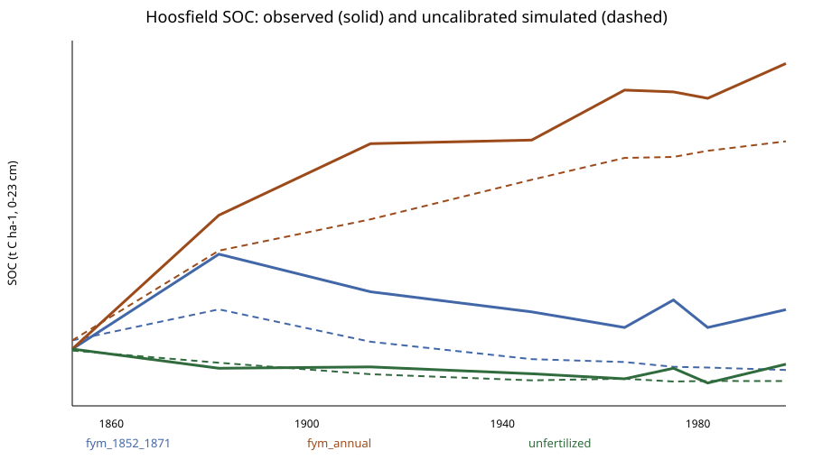

# Phase 9.5 multi-decade SOC validation

## Dataset and design

The versioned local fixture is derived from Rothamsted e-RA dataset
`01-HBSOC1852` v1.0 (updated 2021-04-26). It records Hoosfield treatments,
plots, 0--23 cm depth, years, t C ha-1 stocks and source preprocessing.
The upstream extraction SHA-256 and normalized local-fixture SHA-256 are stored
separately in the JSON result.

The 1852 observed stock initializes each treatment trajectory. It is not used
to fit a parameter. All 1882--1998 observations are validation data. The run
uses official documented plant-residue and FYM schedules but retains the
simulator's documented monthly temperature pattern; that forcing mismatch is
an explicit limitation. No calibration was attempted.

## Uncalibrated results

| Treatment | MAE (t C ha-1) | RMSE (t C ha-1) | Bias (t C ha-1) |
|---|---:|---:|---:|
| Unfertilized | 1.607 | 2.004 | -1.133 |
| FYM annually | 12.904 | 13.349 | -12.904 |
| FYM 1852--1871 | 11.042 | 11.274 | -11.042 |
| Aggregate | 8.518 | 10.154 | -8.360 |

The negative FYM bias is a substantive failure, not hidden by calibration.
It indicates that the uncalibrated model/configuration does not reproduce the
observed manure-treatment stock accumulation. This exercise validates neither
AMF dynamics nor the protected-SOC proxy.

The January 1852 one-step RothC parity test remains a separate equation-
verification test and is not described as long-term validation.
